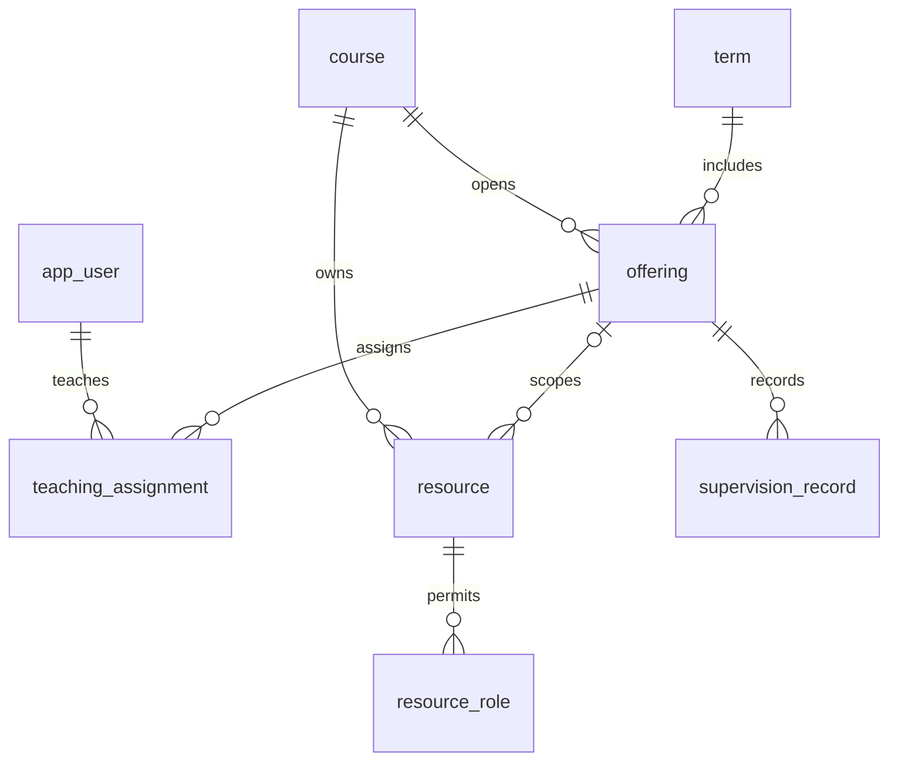

# 概念模型 Conceptual model / Mô hình khái niệm

每个开课必须有一个课程和学期。一个教师可任多个开课，一个开课可有多教师；K99当前可无教师。资源必属课程，可另限定同课程的一个开课。督导事实必须属于一个开课。角色允许集合是资源的多值属性，在逻辑阶段展开，不虚构新的业务用户。

|决定|内容|来源|
|---|---|---|
|D-001|term/user/course/offering/resource为独立实体；事实记录依附开课并有独立记录ID|DR-003—010|
|D-002|teaching_assignment为N:M关系；资源允许角色为集合，在逻辑模型落关联表|DR-007、009、012|
|D-003|系名称是当前身份和课程的属性，无部门维护流程，不另加部门层级实体|BA-03；DR-004、005|
|D-004|记录收集状态独立于记录数量，不由空集合推导|DR-020、031|

贯穿原则：每个结果都证明“当前身份可查看的具体开课及其真实关联内容”，未知状态保持未知。应用于任课、资源作用域、督导来源以及汇总。只读流程均可由这些关系表达；生产权限与数据量仍未知，不影响当前模拟模型。

2026-10-11 Stage 4 reconciliation：图中显式展开任课与资源角色关系表，对齐实际8表；仅teacher可以出现在任课关系，专属resource的课程一致性由复合FK保护。没有新增业务实体。
